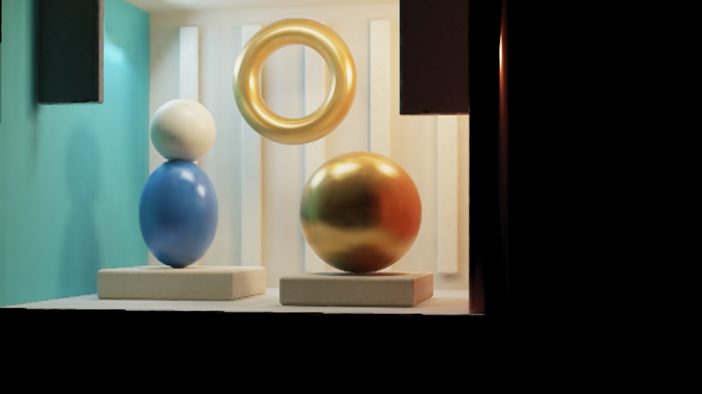

# Neural Light - Experimental C16

A scene-specific renderer that evaluates compact baked appearance at **480x270**, then uses a **4,000-parameter** residual network to produce **1920x1080** output. This package preserves the October 10, 2026 C16 experiment: directional surface textures, a small appearance correction and a separate pixel-only second pass.

The appearance assets occupy **1,077,260 bytes**. This is an experimental demonstration with remaining contour and reflection artifacts. It has not established an overall quality or performance win, and its learned appearance is specific to this scene.



The matched **[bilinear image](docs/images/12000017-bilinear.png)** and **[native physical reference](docs/images/12000017-reference.png)** support comparison at 100% scale. These are unchanged 1920x1080 files from the same frozen camera. The C16 and bilinear panels are actual engine outputs using identical first-pass LR color.

## What runs

1. Resolve four low-resolution quarter-site visibility samples on the known mesh.
2. Evaluate a 16,384-texel directional appearance bake and a small32 latent/MLP correction.
3. Convert the corrected LR color for the CNN input; bilinearly interpolate associated linear color for the base image.
4. Predict phase-specific display-space RGBA residuals with C16 and compose native FHD output.

The baked lighting and learned weights are specific to fixed geometry, materials and lighting. Camera motion changes view-dependent appearance. The weights may store supervised scene detail; there is no claim that absent information is recovered.

C16 consumes only corrected LR display RGBA, its neighborhood and subpixel phase. It has two 3x3 ReLU layers, `4 -> 16 -> 16`, and a 1x1 layer, `16 -> 64`. The outputs correspond to sixteen RGBA phases, with a 5x5 LR receptive field. C16 adds **zero HR rays or guides**. The base still performs **518,400 LR software-BVH visibility queries and 129,600 analytic receiver gates per frame**. The whole renderer therefore includes runtime visibility queries.

See [architecture and exact byte accounting](docs/ARCHITECTURE.md), [measurements](docs/MEASUREMENTS.md) and [related work](docs/RELATED_WORK.md).

## Build and view

The validated native build uses **Windows x64, Visual Studio 2022, Vulkan SDK 1.3.290.0 and Python**. It does not require Python machine-learning libraries for inference. Linux/macOS engine sources are retained upstream, but this integration has not been validated there.

From this directory:

```powershell
python tools/verify_assets.py
powershell -NoProfile -File runtime/build.ps1 -VulkanBin "$env:VULKAN_SDK\Bin"
```

Runtime initialization requires a separately supplied OpenArena 0.8.8 installation and q3map2 executable. Game data, BSPs, compiler/runtime binaries and SDKs are not included. The canonical map source is included. Map compilation requires a fresh `work\map` directory for map compilation:

```powershell
powershell -NoProfile -File reproduction/map/compile_map.ps1 -OpenArenaRoot "D:\Games\OpenArena" -Q3Map2 "D:\Tools\q3map2.exe" -OutputDirectory "work\map"
New-Item -ItemType Directory -Path "runtime\session\baseoa\maps" -Force
Copy-Item -LiteralPath "work\map\neural_test.bsp" -Destination "runtime\session\baseoa\maps\neural_test.bsp"
powershell -NoProfile -File runtime/run.ps1 -OpenArenaPath "D:\Games\OpenArena" -PrepareOnly
powershell -NoProfile -File runtime/run.ps1 -OpenArenaPath "D:\Games\OpenArena"
```

The [full recipe](docs/REPRODUCTION.md) documents tool versions, map staging, explicit path arguments, offline teacher generation and training. The launcher prepares an isolated home directory; it does not modify OpenArena's installed game data. Its default is the admitted frozen camera 12000017 and experimental C16 mode 10. `-FrozenViewId -1` selects a free camera. Running the launcher opens the interactive engine; packaging checks do not launch it.

The retained assets make inference available without rendering a training dataset or refitting any network. Full retraining is a separate offline workflow. The [408-view capture checklist](reproduction/capture/README.md) includes source-only batch preparation and completion checking; the [fresh-fit identity procedure](docs/IDENTITY.md) includes strict byte inspection and manual review/rebuild steps. These do not automate a new end-to-end reproduction. The label dataset and optimizer checkpoints are deliberately omitted.

## What was observed

Across 24 disjoint fresh cameras, descriptive mean RGB MSE was **0.0002571** for C16 versus **0.0005236** for bilinear. C16 made many contours sharper, but false-bright pixels increased from 301.1 to 627.5 per view. Reflection bands, phase-grid edges, halos and motion instability remain possible. The selected model failed 164 visual guards, and the finite physical references failed some noise checks. See [limitations and evidence scope](docs/MEASUREMENTS.md).

Original whole-GPU-frame medians were **13.790 ms C16 / 9.042 ms bilinear** on a GTX 1650 with Max-Q Design. These are single capture samples across cameras, explicitly timing-ineligible. They do **not** establish FPS, a quiet repeated benchmark or a speedup at matched quality. The captures' view 7 presentation also differs from the final view 6 full-scene preview.

The engine/CPU decoder matched deterministic samples in six selection views; the worst C16 RGBA difference was 1.788139343e-7. This is sampled numerical parity, not exhaustive geometric visibility verification.

## Release contents

- `runtime/`: preserved modified Quake3e source and GLSL, with portable build and launch adapters.
- `assets/`: exact selected bake, correction, C16, geometry/BVH/materials and small owned initialization support files.
- `reproduction/`: procedural scene, frozen camera cohort, numeric models, offline recipe and training adapters.
- `docs/images/`: three unchanged matched native screenshots.
- `provenance/`: public relative-path identities and hashes; no private machine paths.
- `docs/PUBLISHING.md`: local review and manual publication procedure.

The port relocates file paths and disables the Windows build's optional CURL download support to avoid shipping a prebuilt library. Renderer shaders and selected appearance assets remain unchanged. The portable build compiled and validated 17 shaders and built the engine on one CPU worker. It has not had a new GPU pixel-parity run; the original native captures and parity evidence remain the numerical evidence.

## Licensing and attribution

The original standalone project code, procedural scene, bake/model assets, screenshots and documentation are licensed under [MIT](LICENSE.md), within the rights held by the project author, `gator`. The Quake3e/ioquake3/id Software engine and Neural Light modifications integrated into its derived files retain their inherited GPL terms. Vulkan headers and other third-party components retain their own licenses and notices. [The license map](docs/LICENSING.md) identifies these separate scopes; MIT does not apply uniformly to the combined renderer.

The repository is `alegator-cs/bake_neural_upscale_demo`; the package retains the Neural Light Experimental C16 identity. Close prior art includes surface light fields, SNeRG, MobileNeRF and neural texture compression; no novelty claim is made. Later JBU, coverage and overnight neural SR prototypes are outside this preserved release.
