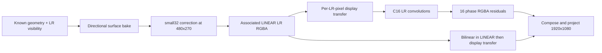

# Architecture and storage

The preserved scene is a fixed procedural alcove with 18 objects, 8 materials, 10,936 triangles and 88 surface charts. It uses explicit lights and no imported textures or HDRI. The original October 10 geometry is retained, including its known coplanar triangle/chart-ID ambiguity.

## First pass

Four quarter-site visibility queries per LR pixel choose surface triangles and barycentrics through a software BVH. Runtime UV, normal, reflection direction, roughness and surface footprint feed the baked appearance path. The directional atlas has 16,384 texels with 12 FP32 coefficients each. The small32 correction adds a four-component latent atlas and a `34 -> 32 -> 32 -> 3` MLP. The network has 2,275 parameters; the 4-channel atlas has 65,536 values. Lighting is baked/fitted rather than path traced each frame.

The renderer also applies 129,600 analytic receiver-center gates. Coverage/color resolution occurs before the second pass. Binary site membership and center gating are not exact per-object FHD fractional coverage. C16 does not repair every geometric ownership ambiguity.

## Second pass

C16 operates on corrected display RGBA. It uses two 3x3 convolutions with ReLU, `4 -> 16 -> 16`, and a 1x1 phase head, `16 -> 64`. Sixty-four outputs encode 4x4 phases x RGBA. The receptive field is 5x5 LR pixels; replicate padding at physical frame boundaries matches the training model.

The native implementation has four CNN dispatches: LR display input, conv0, conv1 and the phase head. The first three run at 480x270. The head writes four associated display channels per 1920x1080 output pixel and computes the phase row directly, without allocating a full 64-channel LR head image. It applies tanh residuals to the canonical bilinear base, clamps alpha to [0,1] and projects RGB to [0,alpha].

Interpolation order is fixed: associated LINEAR RGBA is bilinearly interpolated first, then display-transferred once. The CNN input instead uses display-transferred individual LR pixels. Its residual is composed in DISPLAY. Native PNGs store display RGB on black without a second alpha multiplication or gamma transform.

C16 has 4,000 parameters and uses no HR geometry, depth, normal, surface ID, camera or full pixel coordinates. Phase is the integer output location within each 4x4 cell. Scene-specific supervised details may be encoded in these weights.

## Exact assets

| Appearance file | Bytes |
|---|---:|
| matched_A.nlsf | 788,096 |
| matched_A.nlsr | 272,908 |
| matched_C16.nlr4 | 16,256 |
| **Appearance total** | **1,077,260** |

The bake is 786,432 coefficient bytes plus a 256-byte header and 1,408-byte chart table. small32 is 262,144 latent bytes, 9,100 network bytes, a 256-byte header and 1,408-byte chart table. C16 is 16,000 FP32 weight bytes plus a 256-byte header. The latent atlas is already included in small32; do not count it twice.

| Other required runtime file | Bytes |
|---|---:|
| triangles.bin | 1,224,832 |
| visibility.bvh | 240,368 |
| materials.bin | 128 |
| Historical initialization maps/neural_transport.bin | 25,232 |
| Historical initialization textures/neural_transport/reference_480.tga | 518,444 |

These small owned initialization files preserve the original host setup. The full-surface presentation bypasses their historical learned-transport/plate evaluation; they are not the selected C16 training target.

All runtime files above total 3,086,264 bytes. Source, shaders, image examples, scene template and runtime allocations are additional. Model/texture size is not whole-renderer memory.

The C16 LR display buffer is 2,073,600 bytes and each 16-channel activation buffer is 8,294,400 bytes: 18,662,400 bytes total, plus the 16,256-byte model. Retained surface resources in the original build totaled 378,303,680 allocated bytes, including inactive attachments and readback. Ordinary engine/driver/pipeline allocations are outside that subtotal. No continuous whole-process VRAM peak was established.

## Runtime cost scope

The base performs 518,400 software-BVH quarter queries per frame; C16 adds no HR queries or guides. Six surface compute dispatches include LR visibility, appearance and the four CNN stages. This is baked lighting with low-resolution runtime visibility, not a ray-free renderer or an RTX hardware benchmark.

The native implementation and all published measurements belong to this frozen scene and representation. They are not performance claims for unrelated neural rendering or super-resolution architectures.
